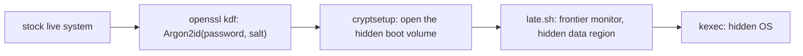

# Stock boot

> [!WARNING]
> Tested in QEMU, including a hidden boot from the real Debian Live 13 image, but not yet on real
> hardware (see [Status](#status)). Rehearse on a spare disk first.

In stock boot, no pd USB exists. The decoy is an ordinary encrypted Linux install that boots on its own.
To use the hidden system, you boot a stock live system (such as Tails) and type a few commands from
memory. pd is used once, during setup, to put the hidden side into the decoy's free space.

**Why.** pd's own boot USB is recognizable now that the repository is public
([threat-model.md](threat-model.md#a2-coercer-in-scope-the-main-design-target)). With stock boot nothing
on any disk or USB stick comes from pd: the decoy is a stock install, the live system is a stock image,
and without its password the hidden side can't be told apart from the random fill around it. What's
left is a configuration fingerprint ([below](#what-could-give-you-away)) and what you remember.

## How it works

The hidden side is the same as with pd's USB ([design.md](design.md)). Its 255 MiB boot volume sits just
below the top of the decoy's thin pool data, at a round sector offset, and is keyed by Argon2id(password,
salt). Its data region lies below that and fills from the top down, while the decoy fills its pool from
the bottom up. Its boot script (`late.sh`) runs the frontier monitor and starts the hidden OS with kexec.

Two things differ:
* **The decoy is whatever you installed,** as long as it uses LUKS around LVM with a thin pool.
* **The boot USB's first stage is typed by hand.** OpenSSL derives the key (its Argon2id gives exactly the
  key pd's own `argon2` does), cryptsetup opens the hidden boot volume, and its `late.sh` does the rest.



On disk, with a partition table and an attached LUKS header:
```
GPT, ESP | LUKS header | LVM: swap | thin pool data ..................................... | tmeta
                                   | decoy fills →             ← hidden data | hidden boot |
```
With a detached header and no partition table, the LUKS data area covers the whole disk, which then
looks wiped.

## 1. The decoy

You choose the distribution, installer, bootloader (GRUB, systemd-boot, a UKI), partition table (GPT or
MBR), and whether the LUKS header is on the disk or detached. These parts matter:

| Requirement | Why |
|---|---|
| Randomize the whole disk before partitioning | Free space must look like everything else. This is the standard drive preparation for full-disk encryption, so it also explains the random free space. |
| LUKS1 or LUKS2 around LVM | Inside the LUKS data area, the hidden side can't be told apart from the random fill. |
| One thin pool, with its data in one contiguous segment, taking (nearly) all of the volume group | The hidden side lives in the top of the pool's data, which the decoy fills from the bottom. A fresh install has one segment. |
| btrfs or XFS on the thin volumes, not ext4 | ext4 spreads its writes over the whole volume ([design.md §2.3](design.md#23-discards-never-to-the-disk-and-to-the-pool-only-at-shutdown)). |
| No discards to the disk | They reveal which blocks hold data ([below](#discards)). |
| No discards into the pool during a session; one `fstrim` at shutdown | Discards during a session walk the pool's allocation toward the hidden side ([design.md §2.3](design.md#23-discards-never-to-the-disk-and-to-the-pool-only-at-shutdown)). |
| No LVM thin snapshots (btrfs snapshots are fine) | Thin snapshots allocate new space for shared data. |
| The LVM layout never changes afterwards | No `pvmove`, no growing or shrinking the pool, no new volumes taking free extents, no new LUKS volume: each can overwrite the hidden side. Reinstalling the OS inside the existing thin volumes is fine. |
| No unencrypted swap partition | It would leak, and some live systems use any swap partition they find. |

### Creating the layout by hand

Fedora's installer can create a thin pool (custom partitioning, "LVM Thin Provisioning"). Debian's and
Ubuntu's installers can't. You can also create the layout with stock commands from a live system, then
install into it; Arch and NixOS install into anything:
```sh
# Randomize the disk (or `pd randomize` from pd's setup environment).
cryptsetup open --type plain --cipher aes-xts-plain64 --key-size 512 \
    --key-file /dev/urandom /dev/nvme0n1 wipe
dd if=/dev/zero of=/dev/mapper/wipe bs=4M status=progress
cryptsetup close wipe

# Partition with any tool (e.g. an ESP and one LUKS partition), then:
cryptsetup luksFormat /dev/nvme0n1p2
cryptsetup open /dev/nvme0n1p2 cryptroot
pvcreate /dev/mapper/cryptroot
vgcreate vg0 /dev/mapper/cryptroot
lvcreate -L 16G -n swap vg0                                       # optional
lvcreate --type thin-pool -l 100%FREE --discards nopassdown -n pool vg0
lvcreate -V 900G -T vg0/pool -n root
mkfs.btrfs /dev/vg0/root                                          # or mkfs.xfs
```
`--discards nopassdown` keeps the pool from passing discards to LUKS even if LUKS were to allow them.
The pool's default, `passdown`, is also safe as long as LUKS doesn't allow discards, because the kernel
then can't pass them down.

### Discards

Check all of these in the decoy:
* `/etc/crypttab` has no `discard` option.
* The kernel command line has no `rd.luks.options=discard`, `rd.luks.allow-discards`,
  `luks.options=discard`, or `:allow-discards` in `cryptdevice=`.
* The LUKS2 header has no persistent `allow-discards` flag: check with `cryptsetup luksDump
  /dev/nvme0n1p2`. To clear it, run `cryptsetup refresh --persistent cryptroot` without
  `--allow-discards`. pd refuses to set up the hidden side while the flag is set.
* On the running decoy, `lsblk --discard` shows 0 under DISC-MAX for the LUKS mapping.
* btrfs is mounted with `nodiscard`: since Linux 6.2 it turns on `discard=async` by itself. No
  filesystem has the `discard` option.
* The periodic trim is off: `systemctl disable --now fstrim.timer` (many distributions enable it).
* One trim runs at shutdown instead, e.g. this unit in `/etc/systemd/system/fstrim-before-umount.service`,
  enabled with `systemctl enable fstrim-before-umount`:
  ```ini
  [Unit]
  Description=Run fstrim on all mounted filesystems before unmounting
  DefaultDependencies=no
  Before=umount.target shutdown.target

  [Service]
  Type=oneshot
  ExecStart=/usr/sbin/fstrim --all --quiet

  [Install]
  WantedBy=umount.target
  ```
  On NixOS, write the same unit in `systemd.services` rather than importing pd's module: the module is a
  pd file, and stock boot keeps those out of the decoy.

## 2. The live system

The hidden boot needs a live system with:
* `cryptsetup`, and `openssl` 3.2 or later (`openssl version`), which has Argon2 (everything else
  comes from the hidden boot volume);
* a kernel with btrfs and kexec support;
* Secure Boot off: with Secure Boot on, the kernel's lockdown mode refuses to kexec a kernel it can't
  verify;
* a root shell.

* **Debian Live 13** desktop images (Xfce, GNOME, KDE, …) have everything (OpenSSL 3.5, cryptsetup 2.7);
  the test suite boots the hidden side from the Xfce one. Log in as `user` (password `live`), then
  `sudo -i`. Debian's "standard" live image (no desktop) has no cryptsetup.
* **Tails 7** (based on Debian 13, with OpenSSL 3.5) should fit too. Set an administration password at
  its Welcome Screen to get `sudo`.
* Recent Fedora and Ubuntu (25.04 and later) live images also ship OpenSSL 3.2 or later.

Check `command -v cryptsetup openssl` and `openssl version` on the image you choose before relying on it.
Nothing from pd goes on the live USB.

## 3. Setting up the hidden side

From pd's setup environment ([install.md](install.md) §1–2), after the decoy is installed and its
discard settings are fixed (§1):

1. **Write `pd.toml`:**
   * `disk` is the whole disk, e.g. `/dev/nvme0n1`.
   * `salt` is something you can reproduce at boot. With an attached header, use the decoy's LUKS UUID
     (`cryptsetup luksUUID /dev/nvme0n1p2`): it's random, and the hidden boot reads it back. Otherwise
     use a string you'll remember: at least 8 characters, from letters, digits, `.`, `_` and `-`. With
     a detached header the UUID is in the header file, which isn't at hand during the hidden boot unless
     you bring the decoy's boot medium, so a remembered salt is simpler.
   * `[[systems]]` lists the hidden OS, and `[argon2]` the Argon2 parameters (they appear in the
     commands you type).
2. **Create the hidden side:**
   ```sh
   python3 -m pd init-hidden --config pd.toml --stock-decoy /dev/nvme0n1p2 --run
   ```
   * Add `--decoy-header FILE` for a detached header.
   * It asks for the decoy's LUKS passphrase and the hidden password, and opens the decoy only
     read-only.
   * It refuses a decoy whose LUKS volume allows discards, or whose thin pool isn't one segment.
   * It stores the decoy's LUKS volume key in the hidden boot volume, for the frontier monitor.
3. **Install the hidden OS** in the shell it opens ([install.md](install.md) §5). The hidden OS needs pd's
   target hook, as with pd's USB. It has no bootloader or ESP of its own (the live system starts it),
   and it must never mount the decoy's ESP.
4. **Learn the commands it prints** (next section), with your offset and salt filled in, and practice
   them before you rely on them.

## 4. Booting

**The decoy** boots as it always does. pd plays no part.

**The hidden system:**
1. Boot the live system and get a root shell (`sudo -i`).
2. Type the commands `pd init-hidden` printed. With pd's default Argon2 parameters they look like this:
   ```sh
   read -rs P
   cryptsetup open -r --type plain -c aes-xts-plain64 -s 512 --sector-size 4096 -o OFFSET \
       -d <(openssl kdf -binary -keylen 64 -kdfopt pass:"$P" -kdfopt salt:SALT \
            -kdfopt iter:14 -kdfopt memcost:262144 -kdfopt lanes:8 ARGON2ID) DISK cryptboot
   unset P
   mkdir -p /mnt/boot && mount -o ro /dev/mapper/cryptboot /mnt/boot && /mnt/boot/late.sh DISK
   ```
   `read` waits for the hidden password, without a prompt or echo. OpenSSL computes Argon2 on a single
   core, so this takes a few seconds (2.6 s for pd's defaults on a fast x86 machine).
3. `late.sh` takes over as on pd's USB:
   * hold Shift for the system menu;
   * the frontier monitor prints the space left between the two sides;
   * the hidden OS starts.

| Placeholder | Example | Meaning |
|---|---|---|
| `OFFSET` | `1945000000` | the hidden boot volume's start sector, printed by `pd init-hidden` |
| `DISK` | `/dev/nvme0n1` | the whole disk |
| `SALT` | `"$(cryptsetup luksUUID /dev/nvme0n1p2)"` | the decoy's LUKS UUID, read back; or your salt itself |
| `14`, `262144`, `8` | | Argon2 passes, memory in KiB (2^`m_log2`) and lanes: pd's defaults, or your `[argon2]` |

### What to memorize

* how to get a root shell in your live system;
* the fixed text of the commands above;
* three values: the offset, the disk, and the LUKS partition (or your salt).

Everything else is inside the hidden boot volume: the data region's layout and key, the tools, the boot
logic. The values change only if you change the salt or the Argon2 parameters (`pd rekey`) or create
the hidden side again.

If cryptsetup reports the disk as busy, the live system is using one of its partitions (e.g. it mounted
the ESP): unmount it. The hidden side maps the whole disk, and the kernel refuses that while a partition
is in use.

To practice without booting anything, run the first three commands, then `mount -o ro
/dev/mapper/cryptboot /mnt/boot && ls /mnt/boot`, and undo it with `umount /mnt/boot; cryptsetup close
cryptboot`.

**With OpenSSL older than 3.2**, derive the key with the `argon2` and `xxd` tools instead (e.g. `apt
install argon2 xxd`, which downloads them; on Tails, through Tor):
```sh
-d <(printf %s "$P" | argon2 SALT -id -t 14 -m 18 -p 8 -l 64 -r | xxd -r -p)
```

## 5. Maintenance

* **Maintenance access:** `pd open --offset OFFSET` and `pd rekey --offset OFFSET` reach the hidden side
  from pd's setup environment. They also work from a live system, with `pd.pyz` and `pd.toml` copied over
  for the occasion ([install.md](install.md#from-a-live-iso)).
* **The decoy's LVM layout must stay as it is** (see the table in §1).
* **Changing the decoy's LUKS passphrase is fine.** Re-encrypting the decoy (`cryptsetup reencrypt`)
  changes its volume key, and the frontier monitor can then no longer read it.
* **Keep `pd.toml` with the hidden side's records, not near the machine:** it holds the salt and the
  hidden system list (not keys).

## Compared with pd's USB

| | pd's USB | Stock boot |
|---|---|---|
| Decoy | created by pd: plain dm-crypt, no partition table | any distribution with LUKS and LVM thin |
| Decoy boot | pd's USB and the decoy password | the decoy's own bootloader |
| Hidden boot | pd's USB: Enter, one `sed`, the password | a stock live system: a few commands and the password |
| Salt | random, on the USB | the decoy's LUKS UUID, or remembered |
| Argon2 at boot | `argon2`, all cores | OpenSSL, one core |
| Firmware boot entry | deleted on every boot | the firmware may keep one for the live USB |
| FIDO2 ([design.md §4.1](design.md#41-fido2-security-keys-optional)) | optional | not available |
| Secure Boot | off (pd's UKI isn't signed) | the decoy can use it; the hidden boot needs it off |
| Frontier monitor | yes | yes |

## What could give you away

* **The configuration itself.** A thin pool, `nodiscard`, a shutdown trim instead of the timer, random
  free space, and a live USB in your bag are each a reasonable choice. Together, to someone who has read
  this document, they suggest stock boot. A decoy that reflects your own considered choices, and that you
  use, is the defense.
* **The firmware and the decoy's logs.** Some firmware remembers a boot entry for the live USB (pd's USB
  deletes its own): check with `efibootmgr` in the live system, and delete one with `efibootmgr -B -b
  NNNN`. The decoy's logs show the machine off while the hidden system ran
  ([threat-model.md](threat-model.md)).
* **Shell history.** A live system with persistence (e.g. Tails' persistent storage of dotfiles) can save
  the commands you type. Don't persist root's shell history.
* **The password on OpenSSL's command line.** It's visible to other processes in the live session for
  a few seconds (`ps`). A live session has no other users, and nothing is written.

## Status

* **Tested in QEMU** (`tests/test_stock.py`):
  * The decoy is built with stock commands: GPT, ESP, LUKS2 with 512-byte sectors, LVM thin, XFS.
  * `pd init-hidden --stock-decoy` leaves the decoy's LUKS header, LVM metadata and files unchanged.
  * The printed commands, typed in a fresh VM, boot the hidden system, and the frontier monitor reads
    the LUKS decoy.
* **Tested with a real live image** (`tests/test_live.py`, opt-in with `PD_TEST_LIVE=1`; downloads
  Debian Live 13 Xfce, about 3.8 GB): the test logs in on the live system's serial console, types the
  printed commands as root, and the hidden system boots. This covers the live system's systemd and
  udev, its OpenSSL and cryptsetup, and kexec under its kernel.
* **Not yet tested:**
  * real hardware, and Secure Boot;
  * Tails;
  * a detached header;
  * a decoy laid out by a real installer.
